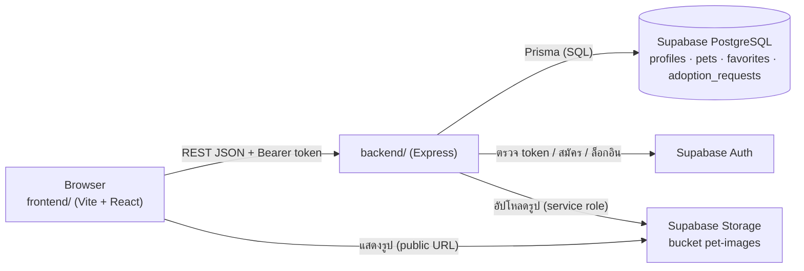

# PawHome

เว็บหาบ้านให้น้องหมาแมวจร — โพสต์หาบ้าน, ค้นหา/กรองน้อง, รายการโปรด, ยื่นและอนุมัติคำขอรับเลี้ยง, อัปโหลดรูป

## Architecture



หน้าเว็บคุยกับ Backend อย่างเดียว ไม่ถือ key ของ Supabase · Backend ถือ service role key และรหัสฐานข้อมูลใน `.env`

## Folder Structure

```
├─ frontend/     Vite + React + TS (UI เดิมทั้งหมด)          → frontend/README.md
├─ backend/      Express + Prisma + Zod + supabase-js        → backend/README.md
├─ database/     schema.sql · mock-data.sql · verification/   → database/README.md
└─ docs/         frontend-audit · backend-api · openapi.yaml · database-design · integration-report
```

## Technology Stack

| ส่วน | ใช้ |
|---|---|
| Frontend | React 19, Vite 6, TypeScript 5.8, React Router 7, TanStack Query 5, Zustand 5, Tailwind CSS 4 |
| Backend | Node.js 22, Express 5, Prisma 6, Zod 3, @supabase/supabase-js 2, multer 2 |
| Database | Supabase PostgreSQL + Auth + Storage, Row Level Security |
| Test | Vitest, Supertest, PGlite (PostgreSQL ในหน่วยความจำ ไม่ต้องใช้ Docker) |

## Installation & Setup

ต้องมี Node.js 22+ และโปรเจกต์ Supabase

### 1. Supabase

1. Supabase Dashboard → SQL Editor → รัน [`database/schema.sql`](database/schema.sql)
2. เก็บค่าไว้ใส่ `backend/.env`:
   - **Project Settings → API:** Project URL (แค่ `https://<ref>.supabase.co` ไม่มี `/rest/v1`), anon/publishable key, service_role/secret key
   - **Connect → Session pooler:** connection string (แทน `[YOUR-PASSWORD]` ด้วยรหัสฐานข้อมูล)
3. **Authentication → URL Configuration:** Site URL = `http://localhost:5173` และเพิ่ม `http://localhost:5173/login` ใน Redirect URLs (ลิงก์ยืนยันอีเมลพากลับมาหน้านี้) — ขึ้นเว็บจริงให้เพิ่มโดเมนจริงด้วย
4. **Authentication → Sign In / Providers → Email:** เปิด "Confirm email" ไว้ = ผู้สมัครต้องยืนยันอีเมลก่อนเข้าสู่ระบบ (บัญชีทดลองจาก `seed:users` ยืนยันให้แล้ว ไม่ต้องยืนยัน)

### การสมัครสมาชิกและอีเมลยืนยัน

- สมัครผ่านหน้าเว็บ = `signUp` ปกติของ Supabase → Supabase ส่งอีเมลยืนยัน · หน้าเว็บบอกให้ไปเช็คอีเมล · ยืนยันแล้วกลับมาที่ `/login?verified=1`
- **ผู้ส่งอีเมลในตัวของ Supabase ส่งได้ 2 ฉบับต่อชั่วโมงทั้งโปรเจกต์** ([Auth rate limits](https://supabase.com/docs/guides/auth/rate-limits)) — ใช้จริงหรือให้หลายคนสมัครพร้อมกันต้องตั้ง Custom SMTP ที่ Authentication → Emails → SMTP Settings
- บัญชีทดลองสร้างด้วย `npm run seed:users` (Admin API ยืนยันอีเมลให้) แยกจากการสมัครสาธารณะ — Backend ไม่ใช้ Admin API ยืนยันอีเมลให้ผู้สมัครทั่วไป

### เดโมที่มีคนล็อกอินพร้อมกันเยอะ (เช่นทั้งห้องเรียน)

ทุกคำขอเข้าสู่ระบบไปถึง Supabase จาก **IP ของ Backend ตัวเดียว** จึงนับรวมกันใน limit ต่อ IP ของ Supabase (ค่าเริ่มต้นตามเอกสาร ณ 16 พ.ย. 2026 — ตรวจค่าจริงของโปรเจกต์ที่ Authentication → Rate Limits):

| Supabase endpoint | ใช้ตอน | ค่าเริ่มต้น |
|---|---|---|
| `/token` | ล็อกอินด้วยรหัสผ่าน + ต่ออายุ token | 150 ครั้ง / 5 นาที / IP |
| `/signup` | สมัครสมาชิก | 30 ครั้ง / 5 นาที / IP |
| อีเมลที่ Auth ส่ง | ยืนยันอีเมล | 2 ฉบับ / ชั่วโมง / โปรเจกต์ (ผู้ส่งในตัว) |

ก่อนเดโม: เพิ่มค่าที่ **Authentication → Rate Limits** ให้พอกับจำนวนคน · ให้นักเรียนใช้บัญชีที่สร้างไว้ล่วงหน้า (เช่นเพิ่มใน `scripts/seed-users.ts`) แทนการสมัครพร้อมกัน · และปรับ `RATE_LIMIT_*` ของ Backend (ค่าเริ่มต้น 10 ครั้ง/นาที/IP) — ถ้านักเรียนใช้ Wi-Fi เดียวกันจะออกมาเป็น IP เดียว ต้องเพิ่มค่านี้ด้วย · เกิน limit หน้าเว็บจะแสดง "ถี่เกินไป กรุณารอสักครู่" (429) ไม่ใช่ "รหัสผ่านไม่ถูกต้อง"

### 2. Backend

```bash
cd backend
npm install
cp .env.example .env       # Windows: copy .env.example .env  แล้วใส่ค่าจากข้อ 1
npm run seed:users         # สร้างบัญชีทดลอง 3 บัญชีใน Supabase Auth
npm run dev                # http://localhost:3000/api/health → {"status":"ok","database":"ok"}
```

### 3. Mock Data

Supabase SQL Editor → รัน [`database/mock-data.sql`](database/mock-data.sql) แล้ว [`database/verification/verify.sql`](database/verification/verify.sql) (ทุกแถวต้อง `ok = true`)

### 4. Frontend

```bash
cd frontend
npm install
cp .env.example .env       # VITE_API_URL=http://localhost:3000/api · VITE_USE_MOCK=false
npm run dev                # http://localhost:5173
```

บัญชีทดลอง (รหัส `123456`): `pong@pawhome.test` · `shelter@pawhome.test` · `mind@pawhome.test`

## Environment Variables

| ไฟล์ | ตัวแปร | หมายเหตุ |
|---|---|---|
| `frontend/.env` | `VITE_API_URL` | ลิงก์ Backend รวม `/api` |
| | `VITE_USE_MOCK` | `true` = ใช้ข้อมูลจำลองในเบราว์เซอร์ ไม่ต้องมี Backend |
| `backend/.env` | `PORT` | ค่าเริ่มต้น 3000 |
| | `CORS_ORIGIN` | โดเมนหน้าเว็บ คั่นด้วย `,` |
| | `DATABASE_URL` | 🔒 connection string (Session pooler) |
| | `SUPABASE_URL`, `SUPABASE_ANON_KEY` | ใช้ล็อกอิน |
| | `SUPABASE_SERVICE_ROLE_KEY` | 🔒 ข้าม RLS ได้ ห้ามอยู่ฝั่งหน้าเว็บ |
| | `STORAGE_BUCKET` | ค่าเริ่มต้น `pet-images` |
| | `APP_URL` | หน้าเว็บที่ลิงก์ยืนยันอีเมลพากลับมา (ค่าเริ่มต้น = โดเมนแรกของ `CORS_ORIGIN`) |
| | `TRUST_PROXY` | `false` (ค่าเริ่มต้น) = ไม่เชื่อ `X-Forwarded-For` · อยู่หลัง proxy ใส่จำนวน proxy เช่น `1` |
| | `RATE_LIMIT_LOGIN_PER_MINUTE` / `_REGISTER_` / `_REFRESH_` | ต่อ IP ต่อนาที ค่าเริ่มต้น 10 / 10 / 30 |

ไฟล์ `.env` ทั้งหมดอยู่ใน `.gitignore` — commit เฉพาะ `.env.example`

## Testing

```bash
cd backend && npm test          # 118 เทสต์ (ไม่ต้องมี credentials)
cd backend && npm run typecheck
cd frontend && npm test         # 17 เทสต์: ต่ออายุ session / refresh token / หลายแท็บ
cd frontend && npm run build    # typecheck + build
cd backend && npm run smoke:live   # ทดสอบทุก endpoint กับ Supabase จริง (ต้องรัน npm run dev ก่อน · dev/demo เท่านั้น)
```

- `npm test` (backend) สร้าง PostgreSQL จำลอง รัน `schema.sql` + `mock-data.sql` (สองรอบ เพื่อตรวจว่ารันซ้ำได้) + `verify.sql` แล้วยิงทุก endpoint ผ่าน Express → Prisma → ฐานข้อมูลนั้น โดยแทนเฉพาะ Supabase Auth/Storage ด้วยของจำลอง
- `npm run smoke:live` สร้างผู้ใช้ทดสอบชั่วคราว ทดสอบ แล้วลบทุกอย่างที่สร้าง (ไม่แตะข้อมูลจำลอง)
- Browser E2E ทำด้วย Playwright (ไม่ได้ติดตั้งในโปรเจกต์) · ทดสอบเองด้วยมือ: [docs/manual-test-checklist.md](docs/manual-test-checklist.md)
- ผลล่าสุด: [docs/integration-report.md](docs/integration-report.md)

## API

21 endpoints ใต้ `/api` — [docs/backend-api.md](docs/backend-api.md) · OpenAPI: [docs/openapi.yaml](docs/openapi.yaml)

## Deploy

- Frontend (Vercel): Root Directory = `frontend` · ตั้ง `VITE_API_URL` เป็นลิงก์ Backend จริง
- Backend: เครื่องที่รัน Node 22 ได้ (Render, Railway, Fly ฯลฯ) · `npm run build && npm start` · ตั้ง `CORS_ORIGIN` และ `APP_URL` เป็นโดเมนของหน้าเว็บ · ตั้ง `TRUST_PROXY=1` (แพลตฟอร์มเหล่านี้มี proxy ข้างหน้า 1 ชั้น ไม่งั้นผู้ใช้ทุกคนได้ IP เดียวกันและโดน rate limit รวมกัน)
- Supabase: เพิ่มโดเมนจริงใน Redirect URLs และตั้ง Custom SMTP ก่อนเปิดให้สมัครจริง

## Known Issues

- Session ต่ออายุอัตโนมัติด้วย refresh token (ดู [backend-api.md → Session](docs/backend-api.md#session)) · ถ้า refresh token หมดอายุหรือถูกยกเลิก จะถูกพาไปหน้าเข้าสู่ระบบ
- ผู้ใช้ที่เคยล็อกอินในโหมดจำลองจะมี token จำลองค้างใน localStorage → ถูกล็อกเอาต์อัตโนมัติเมื่อเรียก API ครั้งแรก
- โปรเจกต์ยังไม่มี ESLint (มีแค่ TypeScript strict + `noUnusedLocals`)
- ลบโพสต์หรือเปลี่ยนรูปแล้ว ไฟล์รูปเก่าใน Storage ยังอยู่ (ยังไม่มีงานลบไฟล์ที่ไม่ได้ใช้)
- ไม่มี pagination (หน้าเว็บแสดง "พบ N ตัว" จากรายการทั้งหมด) — พอสำหรับหลักร้อย-พันโพสต์
- Rate limit ของ Backend นับในหน่วยความจำของ process เดียว — รัน Backend หลายตัวต้องย้ายตัวนับไปที่ร่วมกัน (เช่น Redis)
- บน Windows: `npm run build` ของ backend ต้องปิด `npm run dev` ก่อน (`prisma generate` เขียนทับไฟล์ที่ server กำลังใช้ไม่ได้)
- ปุ่มบนการ์ดโฆษณาเป็นลิงก์ `#` ตามต้นฉบับ (เนื้อหายังเป็น placeholder)
- `mock-data.sql` ใส่ id น้อง 1–12 เอง ใช้กับฐานข้อมูล demo ที่ว่างเท่านั้น (มี guard หยุดเองถ้าเจอข้อมูลผู้ใช้จริง)
