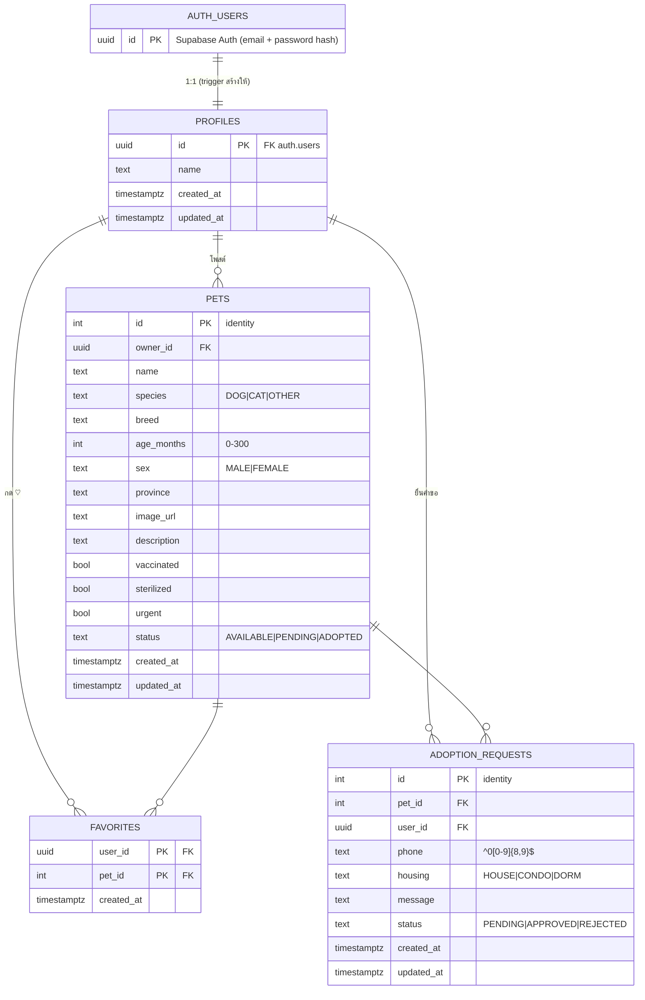

# Database Design — PawHome (Supabase PostgreSQL)

ออกแบบจากข้อมูลที่หน้าเว็บใช้จริง (`frontend/src/types/*.ts`, `frontend/src/api/mockPets.ts`) · SQL: [`database/schema.sql`](../database/schema.sql)

## ER Diagram

## ตาราง (4) และเหตุผล

| ตาราง | หน้าที่ | ข้อจำกัดสำคัญ |
|---|---|---|
| `profiles` | ชื่อที่แสดง (`ownerName`, `userName`) · อีเมล/รหัสผ่านอยู่ใน `auth.users` ของ Supabase เท่านั้น | PK = FK `auth.users(id)` on delete cascade |
| `pets` | โพสต์หาบ้าน | CHECK enum ทุกช่อง · `age_months` 0–300 · FK เจ้าของ cascade |
| `favorites` | ♡ | PK `(user_id, pet_id)` กันกดซ้ำ |
| `adoption_requests` | คำขอรับเลี้ยง | UNIQUE `(user_id, pet_id)` · partial unique index `pet_id WHERE status='APPROVED'` (อนุมัติได้คนเดียวต่อน้อง แม้กดพร้อมกัน) · CHECK รูปแบบเบอร์ |

- **ID:** ผู้ใช้เป็น UUID (Supabase Auth) · น้องและคำขอเป็น `integer identity` เพื่อให้ลิงก์ `/pets/3` เหมือนเดิม
- **Enum:** ใช้ `text + CHECK` แทน `CREATE TYPE` เพื่อให้ `schema.sql` รันซ้ำได้ และเพิ่มค่าได้โดยไม่ต้อง `ALTER TYPE`
- **สถานะน้อง** เก็บเป็นคอลัมน์ (ไม่ใช่ view) เพราะข้อมูลต้นฉบับมีน้องที่ `ADOPTED` โดยไม่มีคำขอ (ไข่ตุ๋น) · Backend คำนวณใหม่ทุกครั้งที่คำขอเปลี่ยน ใน transaction เดียวกัน
- **ลบ:** ลบน้อง → favorites + adoption_requests ของน้องหายตาม · ลบผู้ใช้ใน Supabase Auth → profile, โพสต์, ♡, คำขอ หายตาม
- **Validation ของ UX** (ชื่อ ≥ 2, เรื่องน้อง ≥ 20 ตัวอักษร) อยู่ที่ Backend (Zod) · ฐานข้อมูลกันเฉพาะสิ่งที่ห้ามผิดเด็ดขาด (enum, ช่วงอายุ, ไม่ว่าง, ความยาวสูงสุด)

## Indexes

| Index | ใช้กับ |
|---|---|
| `pets(created_at desc)` | เรียงใหม่สุด + ตัวกรอง `postedWithin` |
| `pets(created_at desc) where urgent` | หน้าแรก "น้องที่ต้องการบ้านด่วน" |
| `pets(owner_id)`, `pets(species)`, `pets(province)` | โพสต์ของฉัน + ตัวกรอง |
| `favorites(pet_id)`, `adoption_requests(pet_id)` | cascade ตอนลบน้อง + คำขอของน้อง 1 ตัว |

ค้นหา (`search`) ใช้ `ILIKE '%คำ%'` ซึ่งไม่ใช้ index — พอสำหรับหลักร้อย-พันแถว ถ้าโตกว่านั้นเพิ่ม `pg_trgm`

## Triggers

- `set_updated_at` — อัปเดต `updated_at` ของ profiles, pets, adoption_requests
- `on_auth_user_created` (บน `auth.users`) — สร้าง `profiles` จาก `raw_user_meta_data.name` อัตโนมัติ (`security definer`, `search_path = ''`)

## Row Level Security

เปิดทุกตาราง · Backend ต่อด้วย role `postgres` ผ่าน Prisma (ไม่ติด RLS) และตรวจสิทธิ์ในโค้ดเอง · RLS มีไว้กันคนเอา anon key ยิงตรงเข้า Supabase REST API

| ตาราง | anon | authenticated |
|---|---|---|
| profiles | อ่าน | อ่าน · แก้ของตัวเอง |
| pets | อ่าน | อ่าน · สร้าง/แก้/ลบ เฉพาะ `owner_id = auth.uid()` |
| favorites | – | ทุกอย่างเฉพาะของตัวเอง |
| adoption_requests | – (มีเบอร์โทร) | อ่าน: ของตัวเอง หรือคำขอของน้องที่ตัวเองโพสต์ · สร้าง: ของตัวเอง สถานะ PENDING ห้ามขอน้องตัวเอง/น้องที่ได้บ้านแล้ว · แก้: เจ้าของน้อง · ลบ: ของตัวเองที่ยัง PENDING |

รวม 11 policies — `verify.sql` ทดสอบพฤติกรรมจริงโดยสวมบท anon และผู้ใช้ "มายด์" · ให้สิทธิ์ระดับตาราง (`GRANT`) ไว้ชัดเจนใน `schema.sql` ไม่พึ่งค่าเริ่มต้นของโปรเจกต์ · `handle_new_user` ถูก `revoke execute` จาก anon/authenticated (เรียกได้จาก trigger เท่านั้น)

## Storage

bucket `pet-images` (public read, ≤ 2 MB, `image/jpeg|png|webp`) · ไม่มี policy ให้ anon/authenticated เขียน — อัปโหลดผ่าน Backend ด้วย service role เท่านั้น · path `<userId>/<uuid>.<ext>`

## Mock Data

ย้ายจาก `mockPets.ts` ครบทุกแถว ไม่มีข้อมูลแต่งเพิ่ม: profiles 3 · pets 12 · favorites 2 · adoption_requests 2 = **19 แถว** ใน public schema (+ ผู้ใช้ 3 ใน `auth.users` ผ่าน `npm run seed:users` รวม 22)

| สถานะที่ UI ต้องแสดง | มีในข้อมูล |
|---|---|
| น้อง AVAILABLE / PENDING / ADOPTED | 9 / 2 (ถั่วแดง, ส้มโอ) / 1 (ไข่ตุ๋น) |
| ด่วน / ไม่ด่วน | 4 / 8 |
| โพสต์ภายใน 24 ชม. / 7 วัน / 30 วัน / เก่ากว่า | 3 / 8 / 12 / – |
| คำขอ PENDING | 2 · APPROVED / REJECTED เกิดจากการกดในระบบ (ต้นฉบับไม่มี) |
| Empty state | มายด์ไม่มีโพสต์และ ♡ · shelter ไม่มีคำขอที่ยื่น |
| รูปเสีย / ไม่มีรูป | ไม่มีในข้อมูล — `PetImage` มี fallback รูปเท้าอยู่แล้ว |

รูป 12 ลิงก์ (Dog CEO, TheCatAPI) ตรวจแล้วตอบ `200 image/jpeg` ทุกลิงก์ (16 พ.ย. 2026) — เป็นลิงก์ภายนอก ถ้าเว็บต้นทางลบรูป หน้าเว็บจะแสดง fallback
